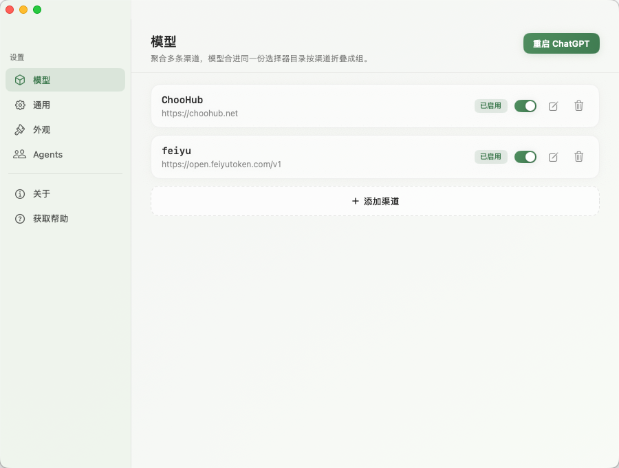

<h1 align="center">GPT Switch</h1>

<p align="center">
  聚合多条渠道，模型合进同一份选择器目录，按渠道折叠成组。
</p>

<p align="center">
  <a href="https://github.com/choohubai/gpt-switch/releases">
    
  </a>
  <a href="https://github.com/choohubai/gpt-switch/releases">
    
  </a>
  <a href="LICENSE">
    
  </a>
</p>

<p align="center">
  <a href="https://github.com/choohubai/gpt-switch/releases"><strong>下载最新版</strong></a> ·
  <a href="#快速上手"><strong>快速上手</strong></a> ·
  <a href="#支持的功能"><strong>支持的功能</strong></a> ·
  <a href="https://github.com/choohubai/gpt-switch/issues"><strong>反馈问题</strong></a>
</p>

GPT Switch 是面向 ChatGPT / Codex 桌面应用的本地模型渠道管理工具。它把不同供应商的模型合进同一份 Codex 模型目录，并在原生选择器里按渠道分组；多个渠道可以同时启用，**不同会话可以分别使用不同渠道的模型**。选中的模型会自动通过所属渠道发送请求，不必为每个供应商反复修改客户端配置。

它不会修改官方应用本体、`app.asar`、代码签名或历史会话。

## 赞助商

感谢以下赞助商对项目的支持。服务范围、价格与活动以各平台官网说明为准。

<p align="center">
  <a href="https://choohub.net">
    
  </a>
</p>

<p align="center">
  <a href="https://choohub.net/"><strong>统一 AI 网关，稳定转发调用</strong></a><br>
  ChooHub 为开发者提供统一的 AI 模型接入服务，通过一套配置即可在 ChatGPT/Codex 工作流中灵活切换所需模型，减少重复接入和环境维护成本，适合个人开发、团队协作与长期项目使用。
</p>

| 赞助商 | 介绍 |
| --- | --- |
| [](https://choohub.net) | [**ChooHub**](https://choohub.net)<br>统一的 AI API 网关，兼容 OpenAI 风格接口，支持多模型路由、会话保持、配额控制与用量统计。 |
| [](https://open.feiyutoken.com) | [**飞鱼Token**](https://open.feiyutoken.com)<br>聚合国内主流大模型，覆盖运营商、云厂商及直连渠道，提供统一 API 接入、用量统计、余额充值和订阅管理。 |

## 支持的功能

- **一个 Codex，同时使用多个渠道的模型。** 多条渠道可以一起启用，**不同会话可以分别使用不同渠道的模型**。各渠道模型会合进同一份模型目录；每个会话选择所需模型后，请求会自动送回对应渠道，不需要来回修改客户端配置。
- **原生模型选择器，按渠道分组。** 每个渠道单独成组并支持折叠。即使只剩一个渠道，也沿用相同展示方式，模型不会混成一张平铺列表。
- **渠道集中管理。** 在同一个面板里配置渠道地址、API Key、自定义请求头、启用状态和独立的模型列表。
- **模型配置完整。** 模型只能从渠道的可用模型列表导入；导入后可以设置显示名称、上下文窗口和输入类型。同一个模型 ID 出现在多个渠道时，会分别保留并归入各自渠道。
- **启用、禁用即时生效。** 开关渠道或删除渠道后，模型选择器会立刻更新，不需要重启 ChatGPT。
- **从端点导入模型。** 「获取可用模型」可以读取渠道兼容的 `/models` 端点，搜索、全选或多选后直接加入当前渠道。
- **配置随时还原。** “关于”页提供当前版本、检查更新和还原配置；还原后会清理 GPT Switch 写入的 Codex 配置与模型目录，同时保留面板里的渠道列表。
- **多套 ChatGPT 外观。** “外观”页提供 WorkBuddy 同系的浅色、深色和主题图片，选择后热更新 ChatGPT 的侧栏、主界面、输入框与弹窗，不需要重启客户端；如果随后在 ChatGPT 设置里改选原生深色或浅色，GPT Switch 会暂停主题覆盖，并自动选中对应的浅色或深色卡片，重新点击任一主题即可恢复。
- **macOS 与 Windows 同源。** 两个平台使用相同的渠道配置、模型目录和请求转发逻辑，可以按需要同时配置多个供应商。

## 快速上手

安装 GPT Switch，添加渠道，完成一次重启即可开始使用。需要接入更多供应商时，继续在同一个面板里添加渠道即可。

<p align="center">
  
</p>

### macOS

1. 从 [GitHub Releases](https://github.com/choohubai/gpt-switch/releases) 下载 DMG，打开后将 `GPT Switch.app` 拖入“应用程序”文件夹。
2. 首次启动如果被 macOS 拦截，打开“系统设置 → 隐私与安全性”，在“安全性”区域点击“仍要打开”，再输入登录密码确认。
3. 点击菜单栏里的 GPT Switch 图标，选择“打开面板”，添加渠道并填写地址、API Key 和模型。
4. 点击右上角「重启 ChatGPT」，然后新建任务并打开模型选择器即可使用。

### Windows

1. 从 [GitHub Releases](https://github.com/choohubai/gpt-switch/releases) 下载 `GPT-Switch-Setup-<版本>.exe` 并完成安装；Windows 没有 macOS Gatekeeper 的额外放行步骤。
2. 从开始菜单启动 GPT Switch，添加渠道并填写地址、API Key 和模型；应用和面板都由原生 `GPT Switch.exe` 承载，不会弹出 PowerShell 窗口。
3. 点击右上角「重启 ChatGPT」，打开模型选择器即可使用。关闭面板后，GPT Switch 会继续在托盘运行。

> 启用、禁用或删除已有渠道会立即更新模型选择器，不需要重启。新增渠道，或者修改地址、API Key、自定义请求头、模型列表等配置后，点一次「重启 ChatGPT」即可应用。

> GPT Switch 会在后台持续监听 ChatGPT，进程检测不受重启重试间隔影响。即使启动时客户端没有运行，之后打开或手动重启时也会自动应用已保存的渠道配置并恢复注入。只有客户端已经运行、但插件无法成功重启它时，才会延长下一次重启尝试的间隔；客户端关闭时立即清零，重新出现后立即接管。

## 配置说明

每个渠道包含：

- **Provider ID：** 写入 Codex `config.toml` 的渠道标识，只能包含字母、数字、`-` 和 `_`。
- **地址：** 供应商的 API Base URL。
- **API Key：** 当前渠道使用的密钥，面板中默认打码显示。
- **自定义请求头：** 可选，用于兼容需要额外认证或路由头的网关。
- **模型列表：** 每个渠道单独维护，只能从渠道端点导入。

模型只能通过「获取可用模型」从渠道端点导入，模型 ID 导入后以只读方式展示，不能手工新增或改写。模型卡片支持设置显示名称、上下文窗口（单位 k）和输入类型。网页搜索、获取和并行工具调用由 ChatGPT/Codex Agent 自身声明，GPT Switch 不维护这些 Agent 能力，也不改写 Agent 的 `web_search` 配置。重新导入并勾选已有模型时，保留已设置的显示名称和上下文窗口。保存渠道配置后会回到渠道列表；涉及 Codex 配置、密钥或模型目录的改动会在点击「重启 ChatGPT」后生效。

左侧“代理”页用于设置转发服务的监听 IP 和端口。默认是 `127.0.0.1:47123`，端口可填 `1024–65535`；只接受 IPv4 地址。保存只会写入 `~/.gptswitch/proxy.json`，点击「重启 ChatGPT」时才同步切换代理。新代理启动成功后会更新 Codex 地址并重启客户端，最后关闭旧代理；切换失败时保留旧代理并恢复原配置。启动时如果目标端口已被占用，会自动顺延到下一个可用端口，并把实际端口写回配置。同一页还能填一个全局出站代理（`http://` 地址，可带用户名和密码），渠道请求、获取模型列表和检查更新都会经过它，留空表示直连；它保存后立即生效，`127.0.0.1` 这类本机地址始终直连，避免代理连本机或转回自己。「测试连接」用当前填写的值探一次，不写入配置；「清除」只清空输入，保存后才落盘。

GPT Switch 的请求转发服务默认监听本机 `127.0.0.1`，按模型 ID 找到所属渠道，再替换为对应渠道的密钥和请求头。客户端当前指向的渠道使用裸模型 ID，其它渠道使用项目内部前缀，因此无需再为每个渠道修改一次客户端配置。代理会把渠道密钥带到监听地址，非回环 IP 会增加密钥暴露风险，除非确有局域网访问需求，否则应保持 `127.0.0.1`。

### 数据与还原

面板中的渠道列表保存在：

- macOS：`~/.gptswitch/channels.json`
- Windows：`%USERPROFILE%\.gptswitch\channels.json`

点击「重启 ChatGPT」后，GPT Switch 会更新 `~/.codex/config.toml`、`~/.codex/auth.json` 和 Codex 模型目录。`config.toml` 与 `auth.json` 同时供 Codex CLI 和桌面端使用，因此重启会同时影响两边。

需要恢复原配置时，进入左侧“关于”，点击「还原配置」。GPT Switch 会撤销自己写入的 provider、密钥和模型目录，并重启客户端；面板中的渠道列表会保留，之后可以继续启用或删除。升级到新版本时，已有的 Codex provider、密钥和旧版模型列表会自动导入为第一个渠道。

### 卸载

先在“关于”页点击「还原配置」，再退出 GPT Switch 并删除应用。直接删除应用会让 Codex 继续指向本机转发端口，而转发服务退出后请求将无法连接；`auth.json` 中也可能保留那份渠道密钥。

<details>
<summary>源码结构</summary>

| 文件 | 作用 |
| --- | --- |
| `Sources/injector.mjs` | 启动客户端、连接本机 CDP，并维护模型选择器注入状态 |
| `Sources/injection.js` | 把启用渠道的模型注入原生选择器，并按渠道折叠成组 |
| `Sources/appearance-config.mjs` | 双端共享的外观主题目录、持久化与运行时色板 |
| `Sources/proxy.mjs` | 在本机回环地址上按模型归属转发请求 |
| `Sources/StatusMenu.swift` | macOS 菜单栏和 Swift 配置面板 |
| `Sources/StatusMenu.ps1` | Windows 桌面配置面板 |
| `Sources/WindowsLauncher.cs` | Windows 原生启动器，并在 `GPT Switch.exe` 进程内承载现有 WPF 面板 |
| `Sources/model-config.mjs` | 模型校验、模型目录合并与读写 |
| `Sources/channel-config.mjs` | 渠道存储、Codex 配置写入与还原、端点模型发现 |
| `Scripts/` | 构建、打包、测试和本地发布脚本 |
| `.github/workflows/release.yml` | 打 tag 后构建并发布 macOS DMG 与 Windows 安装包 |

</details>

### 本地发布

Windows 原生启动器必须在 Windows 上编译。先在 Windows 工作区执行：

```powershell
.\Scripts\build-windows-host.ps1 -OutputPath ".\GPT Switch.exe"
```

把生成的 `GPT Switch.exe` 放到 macOS 发布机，在干净的 `main` 分支指定其路径：

```bash
VERSION="$(plutil -extract CFBundleShortVersionString raw -o - Resources/Info.plist)"
GPT_SWITCH_WINDOWS_HOST="/path/to/GPT Switch.exe" \
  ./Scripts/local-release.sh prepare "$VERSION"
```

确认产物后再执行同一命令和版本的 `publish`。GitHub Actions 的 tag 发布会在 Windows runner 自动编译并测试该 EXE，再交给 macOS runner 打包。

## 兼容性说明

GPT Switch 依赖 ChatGPT 桌面端当前的模型菜单和运行时结构。桌面端升级后，如果模型选择器结构发生变化，项目可能需要同步更新。

## 免责声明

本项目是非官方的社区工具，与 OpenAI、Codex、ChatGPT 及任何中转服务商不存在隶属、授权或背书关系。项目只调整桌面端的模型入口和本机请求路由，不会提供或扩大任何账号、API、模型、付费功能或服务权限；模型出现在选择器中不代表对应服务一定可用。

使用者应自行确认其行为符合所在地法律法规，以及 OpenAI、Codex 和所使用服务商的条款。请在理解源码后自行判断风险决定是否使用。本项目按“现状”提供，不作任何明示或暗示的担保。

## 许可证

本项目采用 [MIT License](LICENSE)。允许使用、复制、修改、分发和商用，但必须保留原始版权及许可证声明。软件按“现状”提供，不附带任何担保。
